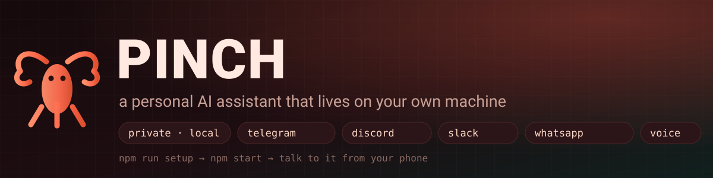
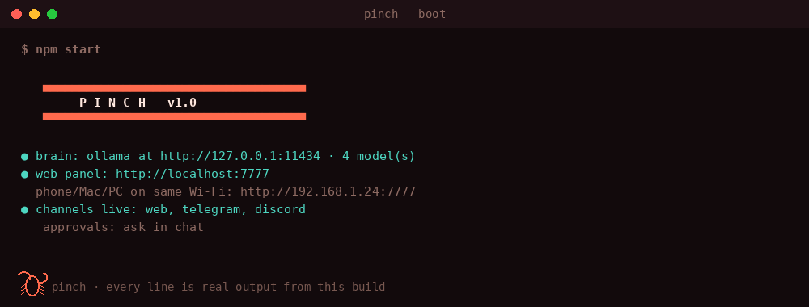

<p align="center">
  
</p>

<h1 align="center">🦞 Pinch</h1>

<p align="center">
  <b>A personal AI assistant that lives on your own machine.</b><br/>
  Reads and writes code. Runs commands. Remembers you. Fires reminders.<br/>
  You message it from Telegram, Discord, Slack, WhatsApp — or talk to it in the browser on your phone.
</p>

<p align="center">
  <a href="https://github.com/RANJITHROSAN17/Pinch/actions/workflows/ci.yml"></a>
  
  
  
  
  <a href="docs/AUDIT.md"></a>
  <a href="LICENSE"></a>
</p>

<p align="center">
  <a href="#one-command"><b>Install</b></a> ·
  <a href="#what-it-can-do">Tools</a> ·
  <a href="#what-leaves-your-machine">Privacy</a> ·
  <a href="docs/AUDIT.md"><b>Security audit</b></a> ·
  <a href="docs/CHANNELS.md">Channels</a> ·
  <a href="#faq">FAQ</a>
</p>

---

```bash
npm run setup     # one guided command: model → channels → voice → key → your phone's URL
npm start         # 🦞  http://localhost:7777
```

That is the whole install. No account, no sign-up, no cloud, nothing to configure by hand.



> *Boot, a real tool call, a streamed reply, an in-chat approval, a reminder arriving, and the
> honesty guard's output format — no model required (`npm run demo`).*

---

## Why this exists

Every "AI assistant" in 2026 wants your conversations on their servers. Pinch does the opposite:

|  | Typical hosted assistant | **Pinch** |
|---|---|---|
| Where your messages go | Their cloud, forever | Your disk — `data/sessions/*.json` |
| Which model runs | Theirs, silently swapped | Yours. `ollama` locally by default |
| What it can touch | Whatever their plugin store allows | Your actual machine, behind an approval gate |
| When it stops working | When they change the pricing page | When you `ctrl-c` |
| Can you read the plumbing | No | under 6,000 lines of plain Node, zero dependencies |
| Account required | Always | Never |

Pinch is not a chat window. It is a **small agent that runs where your files are**, with a
safety model you can actually audit — and which has been audited (see
[the security audit](docs/AUDIT.md)).

---

## What it can do

Ask in plain language. Pinch picks a tool, runs it, reads the result, and keeps going — up to
eight rounds per turn — then answers you normally.

| Tool | What it is for | Approval |
|---|---|:---:|
| `shell` | git, tests, builds, package managers — anything in a terminal | ✅ |
| `read_file` · `write_file` | read code, apply fixes, generate files | write ✅ |
| `list_dir` · `grep` | find where something lives before changing it | — |
| `scan_project` | summarise an unfamiliar repo: tree, stack, README headline | — |
| `search_web` | current facts, docs, error messages | — |
| `calculator` | exact arithmetic, no floating-point guessing (no `eval`) | — |
| `remind` · `list_reminders` · `cancel_reminder` | "remind me in 20 minutes", delivered **back to the chat that asked** | — |
| `open_url` | open a page in your default browser | — |
| `screenshot` | capture the screen to a file | ✅ |
| `system_control` | lock or sleep the machine (shutdown deliberately absent) | ✅ |
| `remember` · `recall` · `forget` | durable facts about you, across restarts | — |
| `add_task` · `list_tasks` · `complete_task` | a lightweight task list | — |
| `time_now` | timezone-correct dates, never a guessed time | — |

Real things it gets used for:

- *"scan ~/code and tell me which repos have uncommitted changes"*
- *"this test fails with a weird error — read it and fix it"*
- *"remind me in 40 minutes to check the deploy"* → it messages you back, in the same app
- *"remember that I only deploy on Fridays"* → it still knows next week
- *"what's on my screen right now?"* → screenshot, then it reads it
- *"explain this stack trace"* — dictated into your phone's mic
- *"hey pinch, open my repo"* — hands-free, while the panel is open

---

## One command

```bash
npm run setup      # guided: model → channels → voice → lock it down
npm start          # panel on http://localhost:7777
pinch pair         # locally-generated QR for your phone
```

The wizard verifies each token against the real service **before** saving it, and refuses to
pretend a bad key is a good one.

**No model installed?** Run the entire thing with a canned brain — proves the plumbing without
downloading 4 GB:

```bash
npm run demo
```

| Requirement | Notes |
|---|---|
| Node.js ≥ 22 (LTS) | `node --version` — 20 reached end of life in April 2026 |
| A model | [Ollama](https://ollama.com) locally (recommended), or any OpenAI-compatible endpoint |
| Optional | `npm install` only if you want the WhatsApp bridge / QR rendering |

Everything else is the standard library. No framework, no transitive tree, no supply-chain
surprise: `package.json` has **no `dependencies` field at all**, and both optional ones (the
WhatsApp bridge, QR rendering) are opt-in.

---

## Talk to it from anywhere

One brain, one memory, one workspace, whichever door you come in through.

| Channel | Setup | How it works | Voice |
|---|---|---|---|
| 🌐 **Web panel** | none | `http://localhost:7777` — installable PWA, works on any device on your Wi-Fi | 🎙️ built in |
| ✈️ **Telegram** | ~2 min | Bot API long polling; approvals arrive as inline buttons | dictation |
| 🎮 **Discord** | ~5 min | Gateway over Pinch's own WebSocket client | dictation |
| 💼 **Slack** | ~5 min | Polls `conversations.history` with a bot token | dictation |
| 💬 **WhatsApp** | ~3 min | Unofficial bridge, **off by default** — read the warning | dictation |

<details>
<summary><b>Telegram, in four lines</b></summary>

1. Message **@BotFather** → `/newbot` → copy the token.
2. Message **@userinfobot** → copy your numeric id.
3. `npm run setup` → paste both.
4. Approvals arrive as **✅ Allow / ❌ Deny** buttons, right in the chat.

Anyone not on your allowlist gets told their own id so you can decide — the bot does not talk to
strangers.
</details>

<details>
<summary><b>Discord and Slack</b></summary>

**Discord** — [discord.com/developers](https://discord.com/developers/applications) → New
Application → Bot → Reset Token. Then **Bot → Privileged Gateway Intents → Message Content
Intent → ON** (Pinch looks deaf without it). Invite it, right-click a channel → Copy Channel ID.

**Slack** — [api.slack.com/apps](https://api.slack.com/apps) → OAuth & Permissions → bot scopes
`chat:write`, `channels:history`, `channels:read`, `users:read`. Install, invite the bot, copy the
`C0123…` channel id.

Full walkthroughs: [`docs/CHANNELS.md`](docs/CHANNELS.md).
</details>

<details>
<summary><b>WhatsApp — the honest version</b></summary>

Pinch supports it. It is **off by default**, because the trade-off is real:

- It uses the **unofficial** WhatsApp Web protocol (Baileys). Automating a personal account
  **violates WhatsApp's Terms of Service**, and accounts have been banned for it.
- **Use a secondary number you can afford to lose.** Never your primary.
- Messages still pass through WhatsApp's servers — private from third parties, not from WhatsApp.

If that bothers you, skip it. Telegram does everything it does, officially, in two minutes.
</details>

---

## Voice, on your phone

The most natural way to use Pinch is to talk to it. Everything here runs in the browser — no app
store, no extra account.

- **Dictation** — tap the mic, speak, send. Language is a dropdown: `EN·IN`, `EN·US`, `தமிழ்`, `हिन्दी`.
  (If you speak Tamil or Hindi, this is the single biggest usability upgrade — it was added for exactly that reason.)
- **Spoken replies** — the panel reads answers aloud with the device's own TTS voice, queued so it
  never talks over itself.
- **`Hey Pinch` wake word** — opt-in, panel-only, off by default. The browser's own recogniser
  matches locally; audio never leaves the device until a command actually follows.
- **Voice notes** — send a voice message from Telegram and Pinch transcribes it, if you point
  `WHISPER_URL` at a local Whisper server.

Add the panel to your home screen first; browsers only grant microphone access on a page you have
tapped.

---

## Reminders that actually fire

Most assistants will happily agree to remind you and then forget. Pinch writes the reminder to
disk, keeps a scheduler alive, and **delivers it to the chat that asked for it** — a Telegram
reminder arrives on Telegram, at 3am, when the panel is closed.

- Understands *"in 20 minutes"*, *"at 6pm"*, *"tomorrow at 9am"*, *"next friday"*.
- If it cannot parse the time, it asks. It never guesses 9am and hopes.
- If delivery is late, it says it is late instead of pretending it was on time.
- If the origin channel is offline, it falls back to the local panel and logs why — it never
  silently disappears.
- Survives restarts: the queue is a JSON file you can read.

---

## The honesty guard

Language models lie in a specific, boring way: they claim things they did not do. *"I've sent the
email."* *"I remember you prefer dark mode."* Prompting does not fix this — checking does.

After every reply, plain JavaScript audits the claims against what actually happened in that turn:

| Code | Caught when the model… |
|---|---|
| `action-without-evidence` | says it sent / saved / deleted something, but no tool that does that ever ran |
| `invented-email` | writes an email address nobody supplied in this conversation |
| `unverified-link` | cites a URL that nothing fetched |
| `memory-without-grounding` | says "you told me…" while memory is empty |
| `denial-not-reported` | claims it cannot do a thing it demonstrably can |

The mismatch is **shown to you, appended to the reply** — never silently rewritten, because a guard
that edits the model's output is a second liar. This is a code-level check, not a prompt: `src/guard.js`,
150 lines, entirely readable.

---

## How it works

```
  Telegram ─┐
  Discord  ─┤                        ┌─→ brain:      ollama (local)  |  any OpenAI-compatible API
  Slack    ─┼──→  channels/  ──→  agent.js  ──→  tools (21)  ──→  your files, your shell
  WhatsApp ─┤        │              │   ↑                          (workspace-confined)
  Panel    ─┘        │              │   └── approval gate ──→ you, in chat
                     │              └──────→ guard.js  (audits the reply before you see it)
                     │
                     └──→  scheduler.js ──→ reminders ──→ back to the channel that asked
```

| File | Job |
|---|---|
| `src/agent.js` | the tool loop: think → call → observe → repeat, max 8 rounds |
| `src/tools.js` | the 21 tools, the workspace sandbox, the command screen |
| `src/brain.js` | Ollama and OpenAI-compatible clients, streaming, tool-call parsing |
| `src/guard.js` | post-reply honesty audit |
| `src/scheduler.js` | reminders, delivery, fallbacks |
| `src/channels/` | Telegram, Discord, Slack, WhatsApp, web |
| `src/server.js` | HTTP + SSE panel API, approval endpoints, host/origin checks |
| `public/index.html` | the whole panel — one file, no build step, no framework |

Read `src/agent.js` top to bottom and you understand the entire product. That is the design goal.

---

## What leaves your machine

The honest table. No "we respect your privacy" paragraph — a list.

| Action | What goes out | Where |
|---|---|---|
| Chat with `LLM_PROVIDER=ollama` | **Nothing.** | your CPU/GPU |
| Chat with `LLM_PROVIDER=openai` | your prompts and tool results | that provider's API |
| `search_web` | the search query | DuckDuckGo |
| `search_web` page fetch | the URL | that website |
| Telegram / Discord / Slack / WhatsApp | the message text | that platform |
| `pinch pair` QR | **Nothing.** Generated locally | your terminal |
| Everything else — memory, sessions, reminders, files, screenshots | **Nothing.** | `data/` on your disk |

Default is local. Cloud is a choice you make in `.env`, never a default that happens to you.

```bash
grep -r "fetch(" src/    # every outbound call in the product, in one command
```

---

## Security model

Pinch is an agent with a shell, so treat it like one. Four layers, in order:

1. **Approval gate** — `shell`, `write_file`, `screenshot` and `system_control` stop and ask a
   human. Default deny. 10-minute expiry. A denial is fed back to the model as text so it stops
   instead of retrying.
2. **Workspace sandbox** — reads and writes are confined to `PINCH_WORKSPACE`, resolved through
   `realpath()` so a symlink cannot walk out of the folder.
3. **Command screen** — a denylist for the unambiguous catastrophes (`rm -rf /`, `rm -rf $HOME`,
   `find / -delete`, `curl … | sh`, `mkfs`, fork bombs, power-off), with a stated reason. Paths
   outside the workspace are **flagged in the approval prompt**, so the human decision is informed.
   The screen is a smoke alarm; the approval gate is the fire door.
4. **Scrubbed environment** — commands never inherit `PINCH_KEY`, `TELEGRAM_TOKEN` or
   `OPENAI_API_KEY`. A `postinstall` script cannot read your bot token.

Plus: `Host`/`Origin` validation on every request (so no website you visit can drive your assistant,
and DNS rebinding fails), a markdown renderer that cannot be broken out of, and no `eval` anywhere —
the calculator is a hand-written shunting-yard parser.

### It was attacked

The suite was green, so I attacked the running build from the outside instead. Six real defects
came out of it — including reading `/etc/passwd` through a workspace symlink, and any website being
able to POST to the assistant and read the reply.

**All six are fixed, each with a regression test that fails on the old code** (27 new tests fail
against the pre-audit commit; 91 pass after).

| Finding | Severity |
|---|---|
| Symlink in the workspace escaped the sandbox → read `/etc/passwd` | Critical |
| Every shell command inherited `PINCH_KEY`, `TELEGRAM_TOKEN`, `OPENAI_API_KEY` | Critical |
| Any website could drive the assistant and read replies (no `Origin` check) | High |
| DNS rebinding via a forged `Host` header | High |
| Panel markdown allowed attribute injection (XSS from model output) | High |
| Command screen missed 9 of 18 payloads; timed-out commands orphaned children | Medium |

Read the full report — method, reproduction commands, fixes, and **what is still not fixed**:
**[`docs/AUDIT.md`](docs/AUDIT.md)** · design notes in [`docs/SECURITY.md`](docs/SECURITY.md).

> A project that shows you its failures is more trustworthy than one that only shows badges.
> The residual-risk register at the bottom of the audit is the part worth reading.

---

## Always-on

```bash
pinch supervise            # restart-on-crash wrapper, any OS, no dependencies
pinch service --install    # systemd unit / launchd plist / Task Scheduler entry
```

Installs only when you ask. `systemctl stop pinch` and it is gone; `data/` and `.env` are untouched.

---

## Command line

| Command | Does |
|---|---|
| `pinch` | start the assistant |
| `npm run setup` | the guided wizard |
| `pinch doctor` | re-verify every token and connection |
| `pinch brain-test` | model speed **and** whether it can call tools at all |
| `pinch chat` / `pinch ask "…"` | terminal use, same brain, same memory |
| `pinch pair` | phone URL + locally-generated QR |
| `pinch supervise` | restart-on-crash wrapper |
| `pinch service --install` | boot-time service |
| `npm run demo` | run everything with a mock brain |
| `npm run audit` | **self-check** — run the adversarial probes against your own install |
| `npm run radar` | what has drifted: runtime, CI matrix, pinned actions |

> `pinch brain-test` exists because a model that chats beautifully but never calls a tool turns
> Pinch into an expensive diary. Better to find out in ten seconds than in a week.

---

## Configuration

Everything lives in `.env`; `npm run setup` writes it. The ones that matter:

| Variable | Default | Meaning |
|---|---|---|
| `LLM_PROVIDER` | `ollama` | `ollama` \| `openai` \| `mock` |
| `OLLAMA_MODEL` | `qwen2.5-coder:7b` | any model you have pulled |
| `PINCH_KEY` | — | shared secret for panel + API; the wizard generates one |
| `PINCH_WORKSPACE` | `~` | the **only** roots the agent may touch — narrow this |
| `PINCH_AUTO_APPROVE` | `false` | skip the approval gate (don't) |
| `PINCH_SHELL_TIMEOUT` | `120` | seconds per command |
| `PINCH_GUARD` | `on` | post-reply honesty audit |
| `PINCH_ENV_PASSTHROUGH` | — | credential names a build may see, comma-separated |
| `PINCH_ALLOWED_HOSTS` | — | extra hostnames (proxy/tunnel), wildcards ok |

Full list with comments: [`.env.example`](.env.example).

---

## Extending it

A tool is an object — no plugin API, no registry, no build step:

```js
// src/tools.js
export const TOOL_MAP = new Map([
  // …
  ["word_count", {
    schema: {
      type: "function",
      function: {
        name: "word_count",
        description: "Count words in a file in the workspace.",
        parameters: { type: "object", properties: { path: { type: "string" } }, required: ["path"] },
      },
    },
    dangerous: false, // true = goes behind the approval gate
    async run({ path }) {
      const text = await readFile(resolveInWorkspace(path), "utf8");
      return { ok: true, output: `${text.split(/\s+/).filter(Boolean).length} words` };
    },
  }],
]);
```

The model sees it on the next turn. `dangerous: true` puts it behind the approval gate
automatically — you cannot forget to add the gate, because the gate is not yours to forget.

---

## FAQ

<details>
<summary><b>Do I need a GPU?</b></summary>

No, but a 7B model on CPU is ~2–4 tok/s — usable, not pleasant. 8 GB of VRAM runs a 7B model
comfortably; 16 GB runs a good one. Apple Silicon works well. The model is the only demanding part;
Pinch itself idles under 100 MB.
</details>

<details>
<summary><b>Can I use ChatGPT / Claude / Groq instead of a local model?</b></summary>

Yes — `LLM_PROVIDER=openai` with any OpenAI-compatible base URL (OpenAI, Groq, LM Studio, vLLM,
OpenRouter). Then your prompts leave the machine, and the privacy table above says so plainly.
Local is the default for a reason.
</details>

<details>
<summary><b>What happens if I deny an approval?</b></summary>

The command genuinely does not run — there is a test for that. The model is told it was denied so it
stops and offers an alternative, instead of retrying the same thing eight times.
</details>

<details>
<summary><b>Can it break my machine?</b></summary>

It can do anything you can do in a terminal, if you approve it. That is the honest answer. Mitigate:
narrow `PINCH_WORKSPACE`, keep `PINCH_AUTO_APPROVE=false`, and read the command in the prompt — the
approval box shows it in full, plus a warning when a path sits outside your workspace.
</details>

<details>
<summary><b>Is my data really local?</b></summary>

`data/` holds sessions, memory, reminders and a plain-text profile. Nothing syncs, nothing phones
home, no telemetry, no analytics, no update check. `rm -rf data` is a valid uninstall.
</details>

<details>
<summary><b>Why "Pinch"?</b></summary>

🦞 A lobster. It lives in a shell, it is territorial about its little rock, and it does not need a
data centre to be useful. That is the whole brand.
</details>

<details>
<summary><b>Why zero dependencies?</b></summary>

Because an agent with shell access should not inherit 700 transitive packages it never read. The
only optional deps are the WhatsApp bridge and QR rendering, and both are opt-in.
</details>

<details>
<summary><b>Does it work on Windows?</b></summary>

Yes — Node standard library throughout, with `shell: true` resolving to `cmd.exe`. `pinch service`
writes a Task Scheduler entry. Screenshots use the built-in PowerShell path.
</details>

---

## Honest limitations

Listed because the absence of this section is usually a lie:

- **Screenshots** need `gnome-screenshot`, `scrot`, `imagemagick` or `grim` on Linux; macOS and
  Windows use built-ins.
- **Voice notes** need `WHISPER_URL` pointing at a local Whisper server; without it, audio messages
  are politely refused.
- **The wake word needs an open panel tab and a microphone.** A browser cannot listen from a closed
  tab, and no amount of wishful README writing changes that.
- **WhatsApp is unofficial** and can get a number banned. Off by default.
- **The command screen is a denylist.** Obfuscated commands still reach the human for approval —
  that is the design, not an oversight. Never run `PINCH_AUTO_APPROVE=true` on a machine you care about.
- **No TLS** in the built-in server. On your LAN that is fine; on the open internet, put it behind a
  proxy and set `PINCH_ALLOWED_HOSTS`.

---

## This repo maintains itself (a little)

Three scheduled workflows, and one deliberate rule: **machines gather facts, humans
make decisions.** No bot commits to `main`, no auto-merge, nothing that opens a PR you
learn to ignore.

| When | What | Why it exists |
|---|---|---|
| Every night | `npm run audit` — the adversarial probes, on a clean checkout | Guard rails rot silently. A refactor in six weeks can reopen a hole no unit test notices, and "we audited it in October" is not a security posture. |
| Every Monday | `npm run radar` — files an issue | Node reach end-of-life; actions go stale; the CI matrix quietly becomes untested-in-practice. Facts are fetched from `endoflife.date` and the GitHub API, never recalled by a model. |
| Every push + daily | CodeQL, dependency review, OpenSSF Scorecard | The boring standard hygiene, on the standard rails. All actions are pinned to commit SHAs. |

```bash
npm run audit     # 14 probes, ~2 seconds, no model, no network
npm run radar     # diffs this repo against the outside world
```

The radar caught something real on its first run: this repo was still claiming and
testing **Node 20, which reached end of life in April 2026**. `engines` is now `>=22`,
and CI runs 22, 24 and 26 (Node 26 became LTS two days ago). That is the whole point of
the job — not to write code, but to make sure somebody notices.

The prompt that turns those facts into a proposal — with the security invariants it may
never touch — is [`.github/prompts/self-improvement.md`](.github/prompts/self-improvement.md).
It is written for a human to run with an agent on demand, on purpose: a weekly unattended
bot PR against an assistant that executes shell commands is a bad trade, and the file says
why at the bottom.

---

## Contributing

Issues and PRs welcome. The bar is simple:

```bash
node --test     # 91 tests, must stay green
```

- New tool? Add a test, and mark it `dangerous: true` if it changes anything.
- New channel? Implement `registerSender`, don't special-case the agent.
- Security-adjacent change? Read [`docs/AUDIT.md`](docs/AUDIT.md) first — every finding there has a
  test that will catch you, and if one of them fails, the change is the problem.
- Style: plain Node, no dependencies, comments that explain *why*, not *what*.

See [`CONTRIBUTING.md`](CONTRIBUTING.md).

---

## Licence

MIT. Do what you like with it.

<p align="center">
  <sub>Built to run on a laptop, in a room, for one person. 🦞</sub>
</p>
